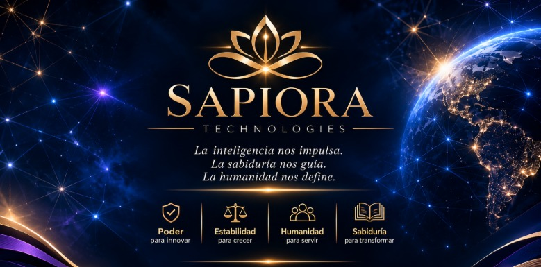

  

<h1 align="center">Natalia Nobba Rinaldi</h1>

<h3 align="center">
  AI Developer in Training | Data Science | Founder of SAPIORA Technologies
</h3>

  Building intelligent solutions through technology,
  knowledge and human-centered innovation.

---

## About Me

I am developing my skills in Artificial Intelligence,
Data Science and Software Development.

My goal is to build innovative technological products
and develop SAPIORA Technologies into an independent
technology company.

## SAPIORA Technologies

**Our mission**

To create intelligent, useful and accessible technological
solutions that improve people's lives.

**Our vision**

To build technology with purpose, combining intelligence,
stability, wisdom and humanity.

## Core Values

- **Power:** The ability to innovate.
- **Stability:** Building trust and lasting solutions.
- **Humanity:** Technology serving people.
- **Wisdom:** Knowledge transforming the future.

## Technologies I'm Learning

- Python
- SQL and MySQL
- HTML5
- CSS
- JavaScript
- Artificial Intelligence
- Machine Learning
- Data Science

## Current Focus

- Building projects from scratch.
- Learning Python and software development.
- Exploring Artificial Intelligence.
- Developing the foundations of SAPIORA.

---

  <i>Intelligence with Purpose. Technology with Humanity.</i>

  © SAPIORA Technologies

